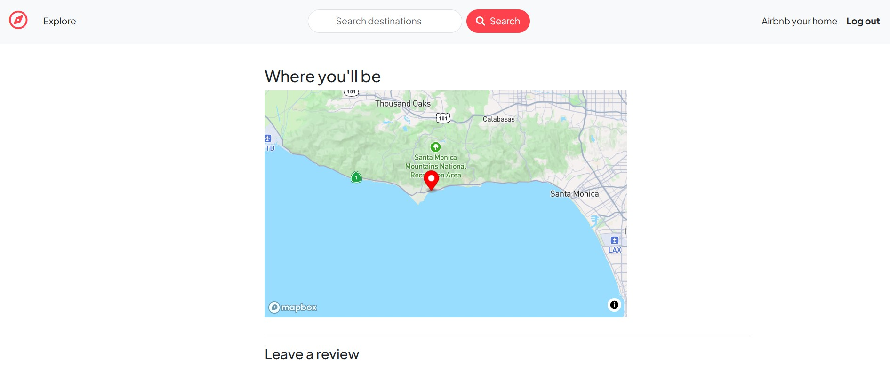

# WanderLust 🧭

An Airbnb-style travel listings platform. Visitors can browse stays on an interactive map. Logged-in users can post their own listings with photos, edit or delete them, and leave star-rated reviews.

- **Live demo:** https://wanderlust-min8.onrender.com
- **Source code:** https://github.com/prashanth-THE-developer/wanderlust

> **Note:** the demo runs on a free hosting plan. If nobody has opened it for a while it goes to sleep, so the first page load can take around a minute. After that it is fast.

## Screenshots

## Screenshots

### Home page


### Login


### Listing page 


### Listing page with map


### Star ratings and reviews


---

## Table of contents

1. [Features](#features)
2. [Tech stack](#tech-stack)
3. [How it works](#how-it-works)
4. [Project structure](#project-structure)
5. [Data models](#data-models)
6. [Routes](#routes)
7. [Security and validation](#security-and-validation)
8. [Environment variables](#environment-variables)
9. [Run it locally](#run-it-locally)
10. [Sample data](#sample-data)
11. [Deploy on Render](#deploy-on-render)
12. [Troubleshooting](#troubleshooting)
13. [Challenges and what I learned](#challenges-and-what-i-learned)
14. [Known limitations and roadmap](#known-limitations-and-roadmap)
15. [Author](#author)

---

## Features

**For visitors**
- Browse all listings with photo, title and price per night
- Open a listing to see its description, owner, location and an interactive Mapbox map with a marker
- Read reviews with star ratings
- Toggle "Display total after taxes" on the home page

**For logged-in users**
- Sign up, log in and log out (after login you are sent back to the page you were trying to open)
- Create a listing: title, description, price, country, location and a photo (JPG, PNG or WEBP, up to 5 MB)
- The location is turned into map coordinates automatically (Mapbox geocoding). If the place cannot be found you see a clear message and nothing is saved
- Edit your own listings, including replacing the photo. The map position is looked up again only when the place changes
- Delete your own listings (with a confirmation popup). Their photo and reviews are deleted too
- Leave a review with a 1 to 5 star rating and a comment
- Delete your own reviews

**Rules enforced on the server**
- Only the owner can edit or delete a listing
- Only the author can delete a review (not even the listing owner)
- Wrong URLs, wrong ids and unknown pages show friendly error pages instead of crashing

---

## Tech stack

| Part | Technology | What it is used for |
|---|---|---|
| Runtime | Node.js 24 | Runs the server |
| Web framework | Express 5 | Routing and middleware |
| Views | EJS with ejs-mate | Server-rendered pages with a shared layout |
| Database | MongoDB Atlas with Mongoose 9 | Stores listings, reviews, users and sessions |
| Login | Passport (local strategy) with passport-local-mongoose | Username and password login, password hashing |
| Sessions | express-session with connect-mongo | Sessions stored in MongoDB so they survive restarts |
| Flash messages | connect-flash | One-time success and error messages |
| Validation | Joi | Checks every form on the server |
| Image upload | Multer with multer-storage-cloudinary | Receives images and stores them on Cloudinary |
| Maps | Mapbox GL JS and the Mapbox geocoding SDK | Interactive map and place-to-coordinates lookup |
| Styling | Bootstrap 5, Font Awesome, custom CSS | Responsive layout and icons |
| Hosting | Render | Runs the live site |

---

## How it works

The project follows the MVC pattern (Model, View, Controller):

```
Browser
   │  request, e.g. POST /listings
   ▼
app.js            sessions, login, flash messages, static files
   ▼
routes/           matches the URL and lists the middleware to run, in order
   ▼
middleware.js     isLoggedIn → upload image → validate form → ...
   ▼
controllers/      the real work: talk to the database, Cloudinary and Mapbox
   ▼
models/           Mongoose models that read and write MongoDB
   ▼
views/            EJS templates turn the data into HTML
   ▼
Browser
```

An example, creating a listing:
1. `isLoggedIn` checks the visitor is logged in (before anything is uploaded)
2. Multer checks the file type and size and uploads the image to Cloudinary
3. `validateListing` checks the form fields with Joi
4. The controller asks Mapbox for the map point of "location, country"
5. The listing is saved with its owner, image and map point, then the user is redirected to the new page
6. If any step fails after the image was uploaded, the image is removed again so nothing is left behind

---

## Project structure

```
wanderlust/
├── app.js                 Server setup: sessions, passport, routes, error handling, start-up
├── middleware.js          isLoggedIn, saveRedirectUrl, isOwner, isReviewAuthor, validation
├── schema.js              Joi rules for the listing and review forms
├── cloudConfig.js         Cloudinary setup, upload storage, image deletion helper
├── package.json           Dependencies and scripts (start, dev), Node version
├── .env.example           List of required environment variables (no secrets)
│
├── controllers/
│   ├── listings.js        index, show, create, edit, update, delete
│   ├── reviews.js         create and delete reviews
│   └── users.js           signup, login, logout
│
├── routes/
│   ├── listing.js         /listings routes
│   ├── review.js          /listings/:id/reviews routes
│   └── user.js            /signup, /login, /logout
│
├── models/
│   ├── listing.js         Listing schema (deletes its reviews when removed)
│   ├── review.js          Review schema
│   └── user.js            User schema (passport-local-mongoose plugin)
│
├── utils/
│   ├── ExpressError.js    Error with an HTTP status code
│   ├── wrapAsync.js       Sends errors from async routes to the error handler
│   └── geocode.js         Place name → map point (Mapbox)
│
├── views/
│   ├── layouts/boilerplate.ejs   Page layout (head, navbar, flash, footer, scripts)
│   ├── includes/                 navbar, footer, flash messages
│   ├── listings/                 index, show, new, edit
│   ├── users/                    login, signup
│   └── error.ejs                 Error page
│
├── public/
│   ├── css/                      style.css, rating.css (star ratings)
│   └── javascript/               script.js (form validation), map.js (Mapbox map)
│
└── init/
    ├── data.js            Ten sample listings
    └── index.js           Seed script (needs the --yes flag)
```

---

## Data models

**Listing**

| Field | Type | Notes |
|---|---|---|
| title | String | required |
| description | String | |
| image | { url, filename } | Cloudinary URL and public id |
| price | Number | per night |
| location, country | String | |
| geometry | { type: "Point", coordinates: [lng, lat] } | required, used for the map |
| owner | ObjectId → User | |
| reviews | [ObjectId → Review] | |

**Review:** `rating` (1 to 5), `comment`, `createdAt`, `author` (ObjectId → User)

**User:** `email` (required) plus `username`, password `hash` and `salt` added by passport-local-mongoose. The plain password is never stored.

---

## Routes

| Method | URL | Who can use it | What it does |
|---|---|---|---|
| GET | `/` | everyone | Redirects to `/listings` |
| GET | `/listings` | everyone | All listings |
| GET | `/listings/new` | logged in | New listing form |
| POST | `/listings` | logged in | Create a listing (with image) |
| GET | `/listings/:id` | everyone | One listing with map and reviews |
| GET | `/listings/:id/edit` | owner | Edit form |
| PUT | `/listings/:id` | owner | Update a listing |
| DELETE | `/listings/:id` | owner | Delete a listing, its image and its reviews |
| POST | `/listings/:id/reviews` | logged in | Add a review |
| DELETE | `/listings/:id/reviews/:reviewId` | review author | Delete a review |
| GET, POST | `/signup` | everyone | Create an account |
| GET, POST | `/login` | everyone | Log in |
| POST | `/logout` | logged in | Log out |

HTML forms can only send GET and POST, so edit and delete forms post to `...?_method=PUT` or `...?_method=DELETE` and the `method-override` package changes the method.

---

## Security and validation

- **Passwords** are salted and hashed (passport-local-mongoose). Plain passwords are never stored or logged
- **Sessions** are stored in MongoDB and encrypted with the `SECRET`. The cookie is `httpOnly`, `sameSite=lax`, and `secure` in production (the app trusts Render's HTTPS proxy)
- Visitors who never log in do not get a session, so bots do not fill the database
- **Logout is a POST request**, so another website cannot log a user out with a link or image
- **Validation with Joi** on every form. Unknown fields are rejected, so nobody can send extra data such as `owner` or `geometry`. Text is trimmed and length-limited
- **Uploads:** only JPG, PNG or WEBP, maximum 5 MB. Login and ownership are checked before anything is uploaded
- **Authorization checks** on the server for edit, delete and review delete, not only hidden buttons
- **XSS protection:** EJS escapes all output. Data passed to the map script is escaped, and the map popup is built with `textContent`
- **Wrong ids** such as `/listings/abc` return a 404 page instead of crashing
- **Errors:** visitors only see a generic message for server errors. The real error is written to the server log
- **Secrets** live in environment variables. `.env` is in `.gitignore`. The app refuses to start if a required variable is missing and tells you which one

---

## Environment variables

Copy `.env.example` to `.env` and fill in your own values.

| Variable | What it is |
|---|---|
| `ATLASDB_URL` | MongoDB Atlas connection string, including a database name (for example `/wanderlust_v2`) |
| `SECRET` | Long random string used to sign and encrypt sessions |
| `CLOUD_NAME`, `CLOUD_API_KEY`, `CLOUD_API_SECRET` | Cloudinary account details for image uploads |
| `MAP_TOKEN` | Mapbox **public** token (starts with `pk.`) |
| `NODE_ENV` | Set to `production` on the live server only |

Generate a `SECRET`:
```bash
node -e "console.log(require('crypto').randomBytes(32).toString('hex'))"
```

If a password in your connection string has special characters, encode them (`@` becomes `%40`, `#` becomes `%23`).

---

## Run it locally

**You need:** Node.js 24 (20.19 or newer also works locally), a free MongoDB Atlas cluster, a free Cloudinary account and a free Mapbox account.

```bash
# 1. Get the code
git clone https://github.com/prashanth-THE-developer/wanderlust.git
cd wanderlust

# 2. Install packages
npm install

# 3. Create your .env file (Windows PowerShell: Copy-Item .env.example .env)
cp .env.example .env
# then open .env and fill in the values

# 4. Start the server with auto-restart
npm run dev
```

Open http://localhost:8080

Atlas setup in short: create a free cluster, create a database user (use a password with letters and numbers only), and under **Network Access** allow your IP (or `0.0.0.0/0`). Copy the connection string from **Connect → Drivers** and add a database name before the `?`.

Scripts:

| Command | What it does |
|---|---|
| `npm run dev` | Starts the server and restarts it when files change |
| `npm start` | Starts the server (what Render runs) |

---

## Sample data

The project includes ten sample listings with coordinates and a demo owner.

```bash
node init/index.js --yes
```

> **Warning:** this **deletes every listing** in the database named in your `.env`, then adds the samples. The `--yes` flag is required on purpose. Never run it against a database that holds real data. It prints a random password for the demo user `wanderlust-demo` once.

---

## Deploy on Render

1. Push the project to GitHub (check that `.env` is **not** in the repository)
2. In MongoDB Atlas, open **Network Access** and allow `0.0.0.0/0` (Render's IP address changes)
3. On render.com choose **New → Web Service** and connect the repository
4. Use these settings:

| Setting | Value |
|---|---|
| Language | Node |
| Branch | `main` |
| Build Command | `npm ci` |
| Start Command | `npm start` |
| Instance type | Free |

5. Add environment variables: `NODE_ENV=production`, `ATLASDB_URL`, `SECRET`, `CLOUD_NAME`, `CLOUD_API_KEY`, `CLOUD_API_SECRET`, `MAP_TOKEN`
6. Click **Create Web Service** and watch the logs. Success looks like `Connected to MongoDB Atlas`
7. Every `git push` to `main` redeploys the site automatically

The Node version comes from `engines` in `package.json` (`24.x`). Always give a version range an upper limit. A range like `>=20` makes Render use the newest Node release, which can break installs.

---

## Troubleshooting

| Problem | Likely cause and fix |
|---|---|
| `Missing environment variable: X` | Add X to `.env` (local) or Render's Environment tab (live) |
| `bad auth : Authentication failed` | Username or password in `ATLASDB_URL` is wrong, or still has `< >` brackets |
| `MongoServerSelectionError` or an SSL alert | Your IP is not allowed in Atlas **Network Access** |
| `Cannot find module ...` on Render | Dependencies did not install fully. Use Node 24.x and `npm ci`, and commit `package-lock.json` |
| Works on Windows, fails on Render | File and folder name capitals must match the code exactly (Linux is case-sensitive) |
| Map is blank | `MAP_TOKEN` missing, or not a public `pk.` token |
| "We couldn't find that location" | Mapbox found no match. Check the location and country spelling |
| Image upload fails | Cloudinary keys wrong, file is not JPG, PNG or WEBP, or larger than 5 MB |
| Changed `.env` but nothing changed | Stop the server (Ctrl + C) and start it again |
| Site is slow on the first visit | The free Render plan was asleep. Wait about a minute |

---

## Challenges and what I learned

I first built this project in my final year but never managed to deploy it. This version was rebuilt from scratch with deployment as the goal. These are the real problems I hit and solved:

- **Missing `start` script and a hardcoded port.** Render runs `npm start` and gives the app its own `PORT`. The server now reads `process.env.PORT`
- **Environment variable names did not match the code** (`CLOUD_NAME` in `.env` but `CLOUDINARY_CLOUD_NAME` in the code). Now there is one list of required variables, checked at start-up with a clear message
- **Sample data could not work on Atlas:** it had no map coordinates, the owner id came from my laptop database and the script connected to localhost
- **Linux is case-sensitive.** Windows hides wrong capital letters in file names, Render does not
- **An open-ended Node version** (`>=20`) made Render pick Node 26 and the install broke. Pinning `24.x` and using `npm ci` fixed it
- **MongoDB Atlas IP allow-list.** A connection that worked at home failed when my IP changed (SSL alert 80)
- **Cloudinary upload options.** The old `allowedFormats` option is silently ignored by the installed version (the correct name is `allowed_formats`), so I also validate the file type and size on the server
- **Cleaning up after failures.** If validation fails after an image was uploaded, the image is deleted so Cloudinary does not fill with unused files
- **Mass assignment.** Strict Joi schemas reject unexpected fields
- **Session design.** Sessions are created only when needed, and cookies are secure behind Render's HTTPS proxy

---

## Known limitations and roadmap

Being honest about what is not finished:

- The **search box** and the **category filter icons** are design elements only and do not filter yet
- The "Privacy" and "Terms" footer links are placeholders
- There are **no automated tests** yet (the code was checked with scripted browser-style tests during development, but they are not part of this repository)
- There are no CSRF tokens. Cookies use `sameSite=lax`, which blocks most cross-site attacks
- `npm audit` reports a Cloudinary SDK advisory (the SDK is held at version 1 because `multer-storage-cloudinary` requires it). This app never passes visitor text to the SDK options. The planned fix is upgrading `cloudinary` with an `overrides` entry and re-testing uploads
- Free hosting means cold starts after inactivity

Ideas for next steps: working search and filters, multiple photos per listing, booking dates, listing categories, pagination, owner dashboard, automated tests, password reset by email.

---

## Author

**Pothula Prashanth**
MERN stack developer, Hyderabad

GitHub: https://github.com/prashanth-THE-developer
